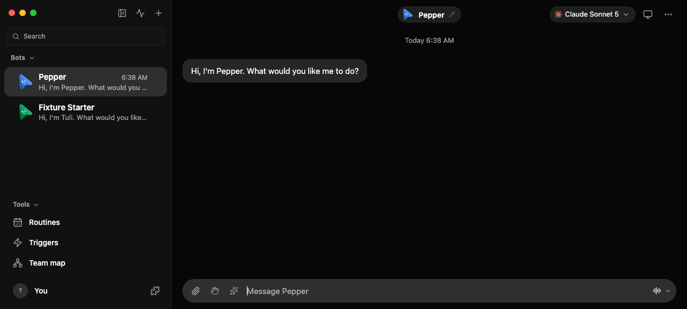
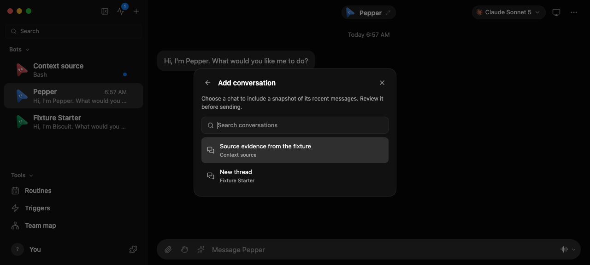
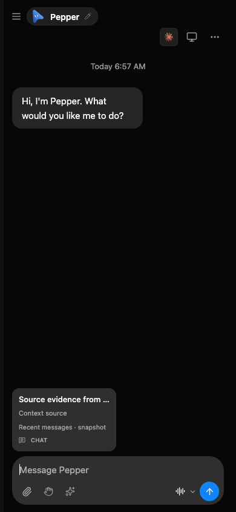

# Attach a conversation as context

The composer paperclip opens **Attach context**. **Attach a file** keeps the
existing file picker; **Add conversation** searches the latest visible bot and
room conversations by title or owner. Bot-to-bot channels and the recipient
conversation are excluded. Selecting a row fetches the existing authorized
messages route, then attaches a frozen snapshot. Nothing is sent until Send.

The snapshot includes at most 50 recent user/assistant text messages and
16,000 characters. Tool results and reasoning are excluded. The chip names
the source and warns when earlier or longer messages were omitted. Source
identity uses the existing canonical thread link; duplicate titles are not
resolved by guessing. Legacy peer-delivered requests keep their bot author
instead of becoming user statements. Context is quoted data and grants no additional access.

## Isolated browser recipe

```sh
pnpm exec vitest run src/lib/conversation-context.test.ts src/lib/composer-attachments.test.ts src/lib/drafts.test.ts src/components/ComposerAttachmentMenu.test.ts
OMB_UI_E2E=1 pnpm exec vitest run scripts/testing/conversation-context-ui.e2e.test.ts
```

The UI recipe launches `control-omb ui launch`: a disposable fake-engine
server, the real App renderer, and an owned headless Chrome. It creates a
source conversation, attaches/removes/reattaches it, reloads the saved draft,
adds a later source message, sends the recipient draft, and checks the stored
request contains only the snapshot selected earlier. It also verifies a
forbidden fetch shows an error without a chip, and closing a pending fetch
prevents even a deliberately late response from attaching anything.

It checks 390px and 1100px layouts and the browser console, and saves
`.context-picker.png`, `.context-390.png`, and `.context-1100.png` alongside
the persistent fixture log in `openmausbot-verification-evidence`.

These are renderer and harness checks with synthetic provider replies, not a
paid model's interpretation of the context. The feature reuses the current
server access rules and never bypasses a refused transcript request.

## UI evidence

Captured on 2026-10-11 from an isolated fake-engine workspace. The selected
source conversation and its stored recipient message were checked through
the real HTTP API. No live conversation or paid model was used.

| Before: file attachment only | After: recent conversation picker |
| --- | --- |
|  |  |


